# Architecture

A technical tour of the CME MDP 3.0 market-data simulator: how bytes are
built, how the price/book model works, how a channel's feeds are published and
recovered, how captures are kept and replayed, and how the dashboard stays honest.

---

## 1. Goal & approach

Emulate the **CME Group MDP 3.0** market-data feed closely enough that a real
feed handler could decode the packets — for the E-mini S&P 500 by default, or any
futures product in CME's channel configuration. Two principles drive the design:

1. **Schema-driven encoding.** The exact wire layout lives in an SBE schema
   (`schema/mdp3.xml`), not in imperative code. The codec reads the schema and
   encodes/decodes accordingly, so swapping in CME's official
   `templates_FixBinary.xml` changes the wire format without touching Python.
2. **Prove the wire.** Nothing trusts engine internals. The consumer and the
   visualization both reconstruct the market **from the decoded bytes**, so if
   the encoding were wrong, the output would be wrong.

A third rule follows from the first: **market structure is data, not code.**
Channels, multicast feeds and product listings come from CME's own `config.xml`;
tick sizes, tick values and expiry cycles live in one table in `contracts.py`.
Nothing about ES is hardcoded in the engine or the transport.

---

## 2. Data flow

```mermaid
flowchart LR
    CFG[schema/config.xml<br/>CME channels + products] --> PRD
    SPC[contracts.py<br/>ticks, cycles, front month] --> PRD[products.py<br/>product chooser]
    PRD -->|tick, channel, feed, securityID| SIM
    PRD --> SET
    SET[settlement.py<br/>prior close + band] -->|start, low, high| ENG
    ENG[engine.py<br/>price + book model] -->|increments, trades| SIM[simulator.py]
    SCH[schema/mdp3.xml] --> SBE[sbe.py<br/>schema-driven codec]
    SIM --> CHP[channel.py<br/>per channel: incremental,<br/>snapshot, definition loops]
    CHP -->|dicts| SBE
    SBE -->|SBE message bytes| PKT[packet.py<br/>packet framing]
    PKT --> TR[transport.py<br/>loss injection + pcap tap]
    TR -->|same bytes on A and B| MC(((UDP multicast<br/>6 feeds per channel)))
    TR -.->|--pcap| PCAP[(pcap file)]
    MC --> CON[consumer.py<br/>rx thread per feed: stamp + enqueue]
    PTP[ptp.py<br/>PTP timestamps] --> CON
    CON --> QUE[(bounded queue)] --> FH[feedhandler.py<br/>A/B arbitration, rptSeq recovery,<br/>definitions]
    MC --> LAD[ladder.py<br/>terminal DOM] --> FH
    MC --> CAP[capture.py] -->|pcap every 3s| S3[(VAST S3 / local dir)]
    S3 --> RPL[replay.py] --> MC
    PCAP --> RPL
    FH --> BK[book.py<br/>per-instrument book]

    ENG -.->|record| REC[record_session.py<br/>build_session]
    REC -->|encode+decode<br/>timeline JSON| APP[app.py Flask]
    APP -->|inject into template| VIZ[dashboard in browser<br/>+ live JS re-sim tuner]
```



`products.py` runs first on both paths: it resolves the product (ES by default)
into a channel, multicast feed, security id and tick size, plus the front-month
contract. `settlement.py` then resolves the opening price (that product's prior
close unless one was passed) and the band the walk runs in, and both are handed
to the engine.

Two paths share the same engine and codec:

- **Live feed:** `simulator.py` → `channel.py` per channel → SBE encode →
  packet frame → `transport.py` → UDP multicast (incremental A and B, snapshot,
  instrument replay) → `consumer.py` / `ladder.py` run it through
  `feedhandler.py`. `capture.py` keeps it as pcap; `replay.py` puts a capture back
  on the wire, indistinguishable to every receiver from the live simulator.
- **Visualization:** `record_session.py` runs the same steps, encodes to SBE,
  **decodes back**, and records a timeline. `app.py` injects it into the
  dashboard template. The in-page tuner re-simulates client-side for instant
  what-if exploration.

---

## 3. Modules

| Module | Responsibility |
|--------|----------------|
| `schema/mdp3.xml` | SBE `messageSchema`: composites, enums, sets, messages, repeating groups. The source of truth for the wire layout. |
| `sbe.py` | Generic, schema-driven SBE codec. Parses the schema into typed objects, then encodes/decodes messages (root block + repeating groups) purely from that model. |
| `packet.py` | MDP transport framing: the 12-byte Binary Packet Header and per-message 2-byte size prefixes. |
| `engine.py` | The `MarketEngine`: bounded random walk of the price, book maintenance, and generation of incremental MD entries + trades. Tick size and tick value are per-instance. |
| `contracts.py` | Contract economics per product (tick, tick value, contract cycle, expiry rule, reference level) and the date arithmetic that picks a front month. |
| `products.py` | Parses CME's `config.xml` and joins it to `contracts.py`, yielding a `Product` with its channel, multicast feeds, security id and front-month contract. |
| `settlement.py` | Resolves where the walk opens: the product's prior close (fetched + cached, stdlib only) and the band derived around it. `prefetch()` warms many symbols concurrently. |
| `ptp.py` | IEEE 1588 receive timestamping: kernel capture where available, TAI formatting, the 10-byte on-wire Timestamp, and latency statistics. |
| `pyver.py` | The Python 3.14 floor, enforced by every entry point. |
| `simulator.py` | Builds up to four instruments, groups them by channel, and drives one `ChannelPublisher` per channel. CLI-configurable. |
| `channel.py` | `ChannelPublisher`: steps each instrument's engine and frames incremental packets (one sequence per channel), the snapshot loop and the definition loop onto the channel's feeds. `Instrument` builds templates 52 and 54. |
| `transport.py` | The one outbound socket: per-feed loss injection, and the pcap tap recording what really went out. |
| `consumer.py` | Feed handler CLI: one receive thread per feed socket into a bounded queue, `feedhandler.py` on the main thread, PTP transit stats. `--raw` keeps the old one-group decoder. |
| `feedhandler.py` | `ChannelHandler`: A/B arbitration with a reorder hold, per-instrument `rptSeq` sequencing, snapshot recovery, definitions. `FeedSet` polls a set of sockets on one thread. |
| `book.py` | MBP book per instrument: incremental apply, snapshot load, ladder rows. |
| `receiver.py` | Multicast join bound to the group address, so feeds sharing a port stay apart. |
| `ladder.py` | curses DOM ladder for up to four products on the feed handler. |
| `capture.py` | Every feed → kernel-timestamped nanosecond pcap windows → S3 and/or disk. |
| `replay.py` | pcap / pcapng / S3 prefixes → multicast at capture timing; `--dry-run` decodes instead. |
| `pcap.py` | pcap writer (synthesized Ethernet/IPv4/UDP) and a pcap + pcapng reader for real captures. |
| `s3store.py` | `config.env` loading, S3 client, `ls`/`get`/`verify`. |
| `launcher.py`, `mdp3` | `./mdp3 up` orchestration and pass-through to every tool. |
| `record_session.py` | `build_session()` — runs a session, encodes+decodes, returns a compact timeline dict. Reused by the app and build script. |
| `app.py` | Flask host. Generates a session per request and serves the dashboard; `/api/session` exposes the raw JSON. |
| `wire.py` | Schema-neutral messages: canonical names ↔ CME's `templates_FixBinary.xml` or the subset, by FIX tag and wire value; mismatch detection; `AutoWire`. |
| `session.py` | Dashboard sessions: `SessionParams`, `simulate()` (publisher → loss → feed handler), `from_capture()`, the `Recorder` that turns datagrams into session JSON. |
| `live.py` | `LiveMonitor` (feed handler on real sockets, snapshots at 5 Hz) and the shared `LiveRegistry`. |
| `app.py` | Flask app factory: dashboard pages, `/api/session`, `.pcap` out, captures in, `/api/live` SSE. |
| `web/` | Front end: `index.html`, `app.css`, `app.js` (views, modes, tuner) and `engine.js` (CPython-identical RNG + engine). |
| `build_dashboard.py` | Bakes a static `dashboard.html`: one session, assets inlined. |
| `test_roundtrip.py` | Asserts encode → bytes → decode is exact, including price scaling and packet framing. |

---

## 4. Channels and feeds (`channel.py`)

CME carries each channel on three kinds of feed, each twice:

| feed | template | packet sequence | purpose |
|------|----------|-----------------|---------|
| Incremental A/B | 46, 48 | one per channel, shared by its instruments | real time |
| Snapshot A/B | 52 | restarts at 1 every loop | rebuild a book |
| Instrument Replay A/B | 54 | restarts at 1 every loop | learn instruments |

A and B carry **byte-identical** datagrams on different groups (channel 310:
`224.0.31.1:14310` / `224.0.32.1:15310`). A channel's incremental, snapshot and
instrument feeds on one side share a **port** and differ only by group
(`224.0.31.1`, `.22`, `.43`, all `:14310`), which is why `receiver.py` binds each
socket to its group address: a wildcard bind on Linux would receive all three.

Products on one channel interleave on its incremental sequence. Each instrument
has its own `rptSeq`, incremented once per MD entry it receives (book or
trade); that per-instrument counter is what makes recovery instrument-level.

**Snapshot (52).** One message per instrument per loop. The root carries
`lastMsgSeqNumProcessed` (the channel's incremental sequence at that moment),
`rptSeq` (the instrument's, at that moment) and `totNumReports` (instruments in
the loop). Entries: every bid and offer level with its `mdPriceLevel`, the last
trade, session open/high/low, cumulative volume, and the prior settlement when
the walk opened from one. The band edges are reported as the high/low limit
prices — the walk can never leave them.

**Definition (54).** Symbol (`ESZ6`), asset, security group, MIC
(`XCME/XCBT/XNYM/XCEC`), `applId` = channel, maturity, `minPriceIncrement`,
`priceDisplayFormat`, unit of measure and contract size, tick value,
`tradingReferencePrice` (the prior close), limits, activation and last-trade
events, the GBX feed depth, eligibility flags and lot rule. CFI codes and
product-complex numbers are representative per asset class, not looked up per
product; event times are plausible shapes, not CME's listing calendar.

Both layouts match `templates_FixBinary.xml` offset for offset; the tests decode
the simulator's 52/54 output with CME's own file.

---

## 5. Feed handler (`feedhandler.py`)

```
            ┌──────────── Incremental A ──┐
 multicast ─┤                              ├─► arbitration ─► per-instrument ─► book
            └──────────── Incremental B ──┘   (first copy     rptSeq check       │
                                               wins; hold      │ skip?            │
                                               ahead-of-seq)   ▼                  │
            Snapshot A/B ───────────────────────────────► RECOVERING: buffer ─────┘
                                                          snapshot → load book,
            Instrument Replay A/B ─► definitions          replay buffer, LIVE
```

**Arbitration.** For each channel, a datagram with sequence `n`:
`n ≤ last` is a duplicate (the other feed's copy, already processed);
`n = last + 1` is processed, then anything held that is now in order;
`n > last + 1` is held, because its predecessor may still be in flight on the
slower feed. Held packets are released as a gap when more than `window` (64)
are waiting or the oldest has waited `hold_ms` (20 ms). Only then is a packet
*lost on both feeds*. Every sequence's arrival set is kept briefly so the
report can say how often each feed covered the other.

**Recovery.** An instrument is `waiting` until its first entry: at `rptSeq` 1
it is live immediately (nothing came before); otherwise it is a late joiner and
starts `recovering`. A live instrument whose next entry skips ahead goes
`recovering` and buffers entries. The next snapshot for it with `rptSeq = r`
replaces the book, buffered entries with `rptSeq > r` are replayed in order, and
it is `live` again; if the buffer itself has a hole after `r`, it keeps waiting
for a newer loop. The rest of the channel is unaffected. While live, every
snapshot whose `rptSeq` equals the book's is compared level by level, so a
divergence would be reported, not silently carried.

---

## 6. Capture and replay (`pcap.py`, `capture.py`, `replay.py`)

Capture is at the socket layer, so no root and no raw sniffing; `pcap.py`
synthesizes the frame around each payload — Ethernet with the RFC 1112 multicast
MAC, IPv4 with a valid header checksum, UDP — from the source address
`recvmsg` reports and the group/port the socket joined. Files are classic pcap,
link type EN10MB, nanosecond resolution by default, timestamped with the kernel
receive time where `ptp.py` can get it. `capture.py` closes a window every
`--interval` seconds into one self-contained object (S3 key
`prefix/host/YYYY/MM/DD/mdp3-…Z-mmm.pcap`) so any window is replayable alone.

The reader is not limited to its own files: classic pcap in both byte orders and
resolutions, pcapng (section/interface/enhanced/simple blocks, `if_tsresol`),
and the link types real captures use — Ethernet with 802.1Q/QinQ tags, Linux
cooked v1/v2, raw IPv4, BSD loopback. IP fragments are skipped and counted.

`replay.py` schedules each datagram at `base + (t − t₀ − cut) / speed` against a
monotonic clock and sends it to its original destination; `--max-gap` folds long
silences into `cut`. Because snapshot and definition feeds are in the capture
too, a replay started at any window recovers in the receiver exactly like a late
join on the live feed.

---

## 7. Wire format

Everything is **little-endian**. A UDP datagram (one "packet") is:

### 7.1 Binary Packet Header (12 bytes)

| Offset | Field | Type | Notes |
|-------:|-------|------|-------|
| 0 | `MsgSeqNum` | uint32 | Packet sequence number, increments per packet (gap detection). |
| 4 | `SendingTime` | uint64 | Nanoseconds since the Unix epoch. |

### 7.2 Message framing (repeats)

Each message in the packet is preceded by its size:

| Field | Type | Notes |
|-------|------|-------|
| `MsgSize` | uint16 | Byte length of the SBE message that follows (header + body). |
| *SBE message* | … | See below. |

### 7.3 SBE message header (8 bytes)

| Offset | Field | Type |
|-------:|-------|------|
| 0 | `blockLength` | uint16 |
| 2 | `templateId` | uint16 |
| 4 | `schemaId` | uint16 |
| 6 | `version` | uint16 |

The **root block** (`blockLength` bytes) holds the message's fixed fields at
fixed offsets, with padding to `blockLength`. Repeating groups follow the block.

### 7.4 Repeating-group dimension (3 bytes) — CME-specific

CME overrides the SBE default (which uses uint16 for `numInGroup`):

| Field | Type | Notes |
|-------|------|-------|
| `blockLength` | uint16 | Size of **each** group entry's block. |
| `numInGroup` | uint8 | Number of entries. |

Each entry is exactly `blockLength` bytes (fields at fixed offsets + padding).

### 7.5 Prices

`PRICE` / `PRICENULL` are `Decimal` composites: an **int64 mantissa** with a
**constant exponent of -7** (the exponent is metadata, not on the wire). So a
displayed price `P` is stored as `round(P × 10⁷)`, and `PRICENULL` uses the
null sentinel `0x7FFFFFFFFFFFFFFF`.

```
5012.00  ->  mantissa 50120000000
5000.25  ->  mantissa 50002500000
```

### 7.6 Worked example (a real packet from this sim)

```
0600 0000  00c6 6259 08b3 cc18  9602  0b00 2e00 0100 0d00  ...
└─MsgSeqNum┘ └─── SendingTime ──┘ MsgSize └blk┘ └tpl┘ └sch┘ └ver┘
   = 6         = 1787000000600000000  = 662  = 11  = 46  = 1  = 13
```

- Packet sequence **6**, sent at `1787000000600000000` ns.
- One message of **662** bytes: template **46** (`MDIncrementalRefreshBook`),
  schema **1**, version **13**, root `blockLength` **11**.
- After the 11-byte block comes the group dimension `2000 14` →
  entry `blockLength` **32**, `numInGroup` **20**.
- The first entry's price mantissa `0082 62ab 0b00 0000` = `50120000000` →
  **5012.00**.

---

## 8. The SBE codec (`sbe.py`)

`Schema(path)` parses the XML once into typed descriptors:

- **`Primitive`** — a primitive type (size, presence, null/const value).
- **`Composite`** — an ordered list of members. `wire_size` excludes constant
  members. A composite is treated as a **decimal** when it has `mantissa` +
  `exponent`, which triggers float ↔ mantissa scaling.
- **`Enum`** — `uint8`- or `char`-encoded, with name↔value maps (so `"Bid"` and
  `'0'` are interchangeable on encode).
- **`SetType`** — a bitset (e.g. `MatchEventIndicator`); encodes a list of
  choice names to bits.
- **`Message`** / **`Group`** — fields at explicit offsets, plus nested groups.

`encode_message(name, root, entries)` writes the SBE header, lays out the root
block, then writes the group dimension + each entry. `decode_message(buf)`
reverses it and returns `{template, id, root, groups}`. The codec is generic —
adding a message or field is a schema edit, not a code change.

**Beyond the basics.** Fixed-length char arrays (`length="20"`, NUL-padded)
for symbols and codes; constant fields that occupy no wire space and decode to
their schema value (`SecurityIDSource` = `8`); optional fields that encode
`None` as their null sentinel and decode it back; plain composites as dicts
(`MaturityMonthYear`); any number of repeating groups per message, filled by name
through `encode_message(..., groups={...})`; and any dimension composite a
group names.

**Namespace note:** the parser matches elements by local name, so the subset's
`sbe:` prefix and CME's `ns2:` (a different URI) both load, and an enum's
`encodingType` may name a type (`uInt8NULL`) rather than a primitive — CME's file
does both, which is why the codec reads it unchanged.

---

## 9. Product selection (`products.py`, `contracts.py`)

Two sources, joined on the product code:

| Source | Supplies | Why there |
|--------|----------|-----------|
| `schema/config.xml` | channel id + label, product listings, multicast connections (ip, port, type, feed) | CME's own file — swap in the real download and addresses are production-accurate |
| `contracts.py` | tick size, tick value, contract cycle, expiry rule, Yahoo symbol, security id | CME's config.xml does not carry contract economics; they are rulebook facts |

Parsing is deliberately tolerant so CME's real file drops in unchanged. CME
nests fields (`<type feed-type="I">Incremental</type>`, `<feed>A</feed>`,
`<group code="ES"/>`); the parser reads each field from a child element *or* an
attribute.

Two filters matter:

- **Futures only.** A product code is listed on its futures channel and on the
  options channels that reference it — `ES` appears on 310, 311 and 323. Only
  channels whose label contains "Futures" and not "Options" are considered, so
  `ES` resolves to 310 and its real `224.0.31.1:14310` incremental feed A.
- **Multicast only.** Historical-replay connections carry a port but no
  multicast `<ip>`; they are skipped.

Products with no `ContractSpec` are filtered out of the chooser rather than
half-supported — with CME's real file that is 2,210 futures products down to the
29 with economics.

### Front month

`front_month()` walks the product's contract months forward and returns the first
whose last trade date is on or after today, so the roll happens the day *after*
expiry. Expiry rules are shape-faithful to the rulebook but holiday-blind:

| Rule | Products | Last trade |
|------|----------|-----------|
| `third_friday` | equity index | 3rd Friday of the contract month |
| `fx` | FX | 2 business days before the 3rd Wednesday |
| `treasury` | ZT–UB | 7 business days before month end |
| `grain` | ZC–ZL | business day before the 15th |
| `crude` | CL | 3 business days before the 25th of the *prior* month |
| `prior_month_end` | NG, RB, HO | last business day of the prior month |
| `metal` | GC, SI, HG, PL | 3rd-to-last business day of the prior month |

---

## 10. Price & book model (`engine.py`, `settlement.py`)

Tick size and tick value are per-`MarketEngine`, supplied by the selected
product; they default to ES (tick **0.25**, **$12.50** per tick). Prices are
snapped with `round_to_tick(px, tick)`, whose outer rounding clears float fuzz —
a Japanese Yen tick is 0.0000005, fine enough that `n * tick` otherwise lands
off-grid.

### 10.1 Opening price

The walk opens at `start` — by default the **previous session's close**, which
`settlement.py` resolves before the engine is constructed:

```
explicit --start ──────────────────────────────► start
        else prior close (Yahoo ES=F, cached) ──► start
        else (offline, no cache) ──────────────► None ─► open at band center
```

`resolve_start_band()` then fills in whichever of `low`/`high` was not supplied,
as a `--band`-wide window centered on the opening price, and reconciles the two:

| Situation | Result |
|-----------|--------|
| explicit `--start` outside the band | clamped into the band, `clamped=True` |
| *prior close* outside an explicit band | dropped; opens at center, `outOfBand=True` |
| neither a start price nor a cache | band falls back to `[5000, 5025]`, opens at center |

The opening price becomes the opening **best bid**, so the opening mid sits half
a tick above it — a one-tick-wide market has no mid on the tick grid. The band
center remains the mean-reversion anchor either way, so a walk that opens away
from the center drifts back toward it.

The lookup is stdlib-only (`urllib`), times out in 5s, caches to
`.prior_close_cache.json` for 4 hours, and never raises: a failed fetch degrades
to the cache (flagged `stale`), and no cache degrades to a center open.

> CME's own settlements service is not used — its Data Terms of Use prohibit
> automated access. The Yahoo figure is a consolidated close, not the official
> CME settlement.

### 10.2 Price path

The engine walks the **best bid** on the tick grid; the best offer sits exactly
one tick above, so the book is never locked or crossed and the mid is the
midpoint. Each step, in tick space:

```
drift  = -θ · (best_bid − center) / tick        # Ornstein–Uhlenbeck reversion
shock  =  N(0, σ)                                # gaussian, σ in ticks
if rand() < jump_prob:                           # occasional gap move
    shock += ±|N(jump_size, 0.3·jump_size)|
best_bid += round(drift + shock) · tick
```

Moves are quantized to whole ticks and the price **reflects** off the band so it
always stays inside `[low, high]`. Knobs:

| Knob | Symbol | Effect |
|------|:------:|--------|
| `volatility` | σ | Std-dev of each shock, in ticks. |
| `reversion` | θ | Strength of the pull toward band center. |
| `jump_prob` | — | Per-step probability of a gap move. |
| `jump_size` | — | Mean magnitude of a jump, in ticks. |

### 10.3 Book & increments

Each step rebuilds the target book: `depth` levels per side, one tick apart,
with size fattening deeper in the book plus noise, and an order count per level.
The engine diffs the previous book against the target and emits MD entries with
`MDUpdateAction` of **New** (level appeared), **Change** (size/orders differ), or
**Delete** (level left the book / band). Because sizes are re-drawn each step,
most levels report **Change** — matching the churn of a real book.

### 10.4 Trades

With ~35% probability per step a marketable order crosses the touch, producing a
`MDIncrementalRefreshTradeSummary` entry at the best bid/offer with an
`AggressorSide` of Buy or Sell and an exponentially-distributed size.

---

## 11. Receive path & timestamping (`consumer.py`, `ptp.py`)

### 11.1 Two threads, one queue

```
 rx thread                    bounded queue                 main thread
 ─────────                    ─────────────                 ───────────
 recvmsg  ──►  timestamp  ──►  put_nowait  ──►  get  ──►  parse → decode → stats
    ▲                              │
    └──── never blocked ───────────┘  full ⇒ drop + count
```

The receive thread does nothing but `recvmsg`, stamp and enqueue. This is not
decoration: while a single-threaded handler is decoding it is not receiving, so
the next packet either waits in the socket buffer — inflating the latency that
packet will later appear to have — or is dropped by the kernel. Splitting them
means the timestamp records when the packet *arrived*, not when the decoder got
round to it.

The queue is bounded and overruns are counted rather than absorbed: an unbounded
queue would turn a slow decoder into unbounded memory growth and silently
falsify the latency distribution. `--no-threads` runs the inline path for
comparison.

`recvmsg` releases the GIL, so this split helps on a stock interpreter; on a
free-threaded 3.14 build the decode side runs genuinely in parallel. The banner
reports which build is running.

### 11.2 Getting a timestamp

Python does not export the timestamping socket constants on every platform, so
`ptp.py` carries them by value and probes in order: `SO_TIMESTAMPNS` (Linux,
`timespec`, nanoseconds) → `SO_TIMESTAMP` (BSD/macOS `timeval` with a 4-byte
`tv_usec`, Linux with 8, microseconds) → a userspace clock read. Whatever it
gets, `ClockSource.describe()` states the mechanism, whether it came from the
kernel, and the resolution actually measured on this host — the advertised
option means little if the OS clock only advances in microsecond steps.

When nothing is available, `synthesize_ancdata()` fabricates the exact control
message the kernel would have attached. The parsing path is then identical on a
machine that cannot timestamp, which is how the tests cover it everywhere — and
the output is labelled `FABRICATED` so a synthesized capture is never mistaken
for a real one.

### 11.3 PTP semantics

PTP counts from the 1970 epoch on the **TAI** timescale, which leads UTC by a
whole number of leap seconds (37 since 2017). `format_ptp()` applies that offset,
and `encode_ptp_timestamp()` produces the 10-byte IEEE 1588 `Timestamp`: 48-bit
seconds plus 32-bit nanoseconds, big-endian.

**This is PTP formatting and measurement, not PTP sync.** No grandmaster
disciplines this host's clock. Transit — `rx timestamp − sendingTime` — is only
meaningful when both ends share a time source; across unsynchronized hosts it is
dominated by clock offset, and the consumer says so when the median goes
negative.

---

## 12. Dashboard (`session.py`, `live.py`, `app.py`, `web/`)

### 12.1 One pipeline, three sources

```
simulated:  build_instruments → ChannelPublisher(clock = simulated) → Transport(loss, no socket) ─┐
capture:    pcap / pcapng → datagrams ────────────────────────────────────────────────────────────┴→ Recorder
                                                                                                   (FeedHandler)
live:       FeedSet sockets → FeedHandler → LiveMonitor snapshots → SSE
```

A simulated session runs the live simulator's own publisher on a simulated clock
(100 ms per step from a fixed epoch, 1 µs between packets), through the
transport's loss model with delivery replaced by a recorder. Every datagram —
including those the loss model dropped, flagged as such — goes to the
`Recorder`, which feeds it to a `FeedHandler` and records what happened to it
(processed first copy, duplicate, held for reorder, dropped, snapshot/definition
loop). After each step it records every tracked instrument's book as the
*handler* holds it. So a recovery in the session is a real recovery: the book
the dashboard draws during it is the stale one the handler had.

A capture goes through the same `Recorder`, with frames on time buckets
(100 ms, or wider to stay under 3,000 frames). Instruments are picked by
activity — a real channel carries far more than four — and named from their
definitions when the capture has them, from `contracts.py` when the security id
is one of the simulator's, else by id with the tick estimated from the book.

Live mode doesn't record: `LiveMonitor` polls the sockets on its own thread and
publishes a snapshot (books, new trades, state, A/B tallies, per-feed rates, new
events) five times a second; each `/api/live` client streams them. Monitors are
keyed by products/schema/interface/feeds and shared, and stop ten seconds after
their last viewer leaves.

### 12.2 Session JSON (v2)

```jsonc
{ "source":   {"kind": "simulated|capture", "name", "params", "command"},
  "schema":   {"name", "label", "id", "version", "auto?", "detected?", "layout": {46: {block, groups}}},
  "channels": [{"id", "label", "feeds": [{kind, feed, ip, port}], "arb": {won, only, lost, …}}],
  "instruments": [{"code", "symbol", "securityId", "channel", "tick", "decimals",
                   "low", "high", "start", "startSource", …, "definition", "summary"}],
  "frames":   [{"t": ms, "i": [{"m", "bb", "bo", "b": [[px,size,orders]], "o", "tr", "s", "r"}]}],
  "packets":  [[t_ms, channel_index, "I|S|N", "A|B", seq, bytes, "win|dup|held|drop|loop", "46,48"]],
  "events":   [{"t", "kind", "text"}],
  "samples":  {"46": {"hex", "segments": [{off, len, path, kind, field, type, value, canonical}]}} }
```

`segments` come from `Schema.explain()`: a contiguous attribution of every byte
of the message — header, root fields, padding, group dimensions, entries — with
the packet header and `MsgSize` prefixes added by the recorder.

### 12.3 The in-page engine

`web/engine.js` ports `engine.py` *and* CPython's `random.Random`: MT19937 with
`init_by_array` seeding, the 53-bit `random()`, `gauss()` with its cached second
value, `uniform`, `expovariate`, and Python's round-half-even and truncating
`int()`. A preview is therefore the simulator's walk for that seed, not an
approximation; `test_dashboard.py` runs it under node against `engine.py` (24
random configurations × 300 steps, books, sizes and trades identical). The one
caveat is the platform's `cos`/`log`: V8 and libm can differ in the last bit of
a `gauss()` value, which would only matter if it straddled a rounding boundary.

The page renders whatever it has — preview frames, the server session, or live
history — through the same views; preview updates are instant, and the
authoritative server session (debounced, cancellable) replaces them.

### 12.4 Front-end practice

The session is embedded as `<script type="application/json">` with `<`, `>`, `&`
escaped, never interpolated into script; every dynamic string goes through an
HTML escaper (captures carry arbitrary bytes); the page ships with a
Content-Security-Policy that allows only its own scripts. State lives in the URL
(`history.replaceState`), so any view can be bookmarked. Light and dark follow
the system; motion respects `prefers-reduced-motion`; tabs, the inspector table
and the drop zone are keyboard reachable.

---

## 13. Extending it

- **Production parity:** the codec loads CME's official `templates_FixBinary.xml`
  as is. Emitting it would mean renaming the simulator's fields to CME's
  (`mdEntryPx` → `MDEntryPx`) and moving 46/48/30 to exponent -9; 52 and 54
  already match it.
- **New message type:** add a `<sbe:message>` to the schema, then build the dict
  and call `encode_message(...)`. No codec changes.
- **New dynamics:** add the knob to `MarketEngine.__init__` and the step math,
  expose it in `channel.build_instruments`, `SessionParams` and the CLI flags,
  and mirror it in `web/engine.js` (keeping the RNG call order identical — the
  parity test will tell you) plus a slider in `web/index.html`.
- **Market by order:** `SnapshotFullRefreshOrderBook` (53) and
  `MDIncrementalRefreshOrderBook` (47) on the Snapshot-MBO feeds `config.xml`
  already lists; the engine would need order ids.
- **Hardware timestamps:** on Linux with a PTP-capable NIC, add
  `SO_TIMESTAMPING` (37) with `SOF_TIMESTAMPING_RX_HARDWARE` to the probe list in
  `ptp.py`; it yields a three-`timespec` control message. Everything downstream
  already works in nanoseconds.
- **New product:** add a `ContractSpec` to `contracts.py` (tick, tick value,
  contract cycle, expiry rule, Yahoo symbol). Its channel and multicast feed come
  from `config.xml` automatically — nothing else to wire.
- **Real channel addresses:** download CME's `config.xml` to `schema/config.xml`;
  the committed extract is only a fallback.

---

## 14. Fidelity: faithful vs. simplified

**Faithful:** little-endian SBE; packet header + size-prefixed framing; 8-byte
SBE header; CME's 3-byte group dimension; int64 mantissa prices;
`MDUpdateAction` / `MDEntryType` / `AggressorSide` enums; `MatchEventIndicator`
bitset; with `--schema cme` (the default when the file is present) every
template is CME's own layout from CME's own file — 46/48 with exponent -9 prices
and their order-id groups — and with the subset, 52/54 still match it byte for byte;
incremental A/B with identical bytes, per-channel sequence shared across
instruments, per-instrument `rptSeq`, snapshot and instrument-replay loops whose
sequence restarts each loop; channels, all six multicast feeds and product
listings read from CME's own `config.xml`; real tick sizes and tick values.

**Simplified (by design):** the schema is a hand-authored subset of CME's, not
the full production template, and its 46/48/30 price at exponent -7 where CME's
v13 uses -9 (use `--schema cme` for production layout); the book is Market-by-Price only (no MBO order IDs); no
implied/spread markets, no TCP replay; one incremental packet per instrument per
step rather than CME's event batching; definitions are sent on the replay loop
only, not as intraday adds on the incremental feed; the price process is a
statistical model, not real order-flow matching.
Security IDs are synthetic rather than read from the definition feed, expiry
rules ignore exchange holidays, and treasuries are quoted decimally rather than
in 32nds. Timestamps are PTP-formatted but not PTP-disciplined, and are software
timestamps — kernel where the platform allows, never NIC hardware. Drop in the official schema and add messages to close the gap.
