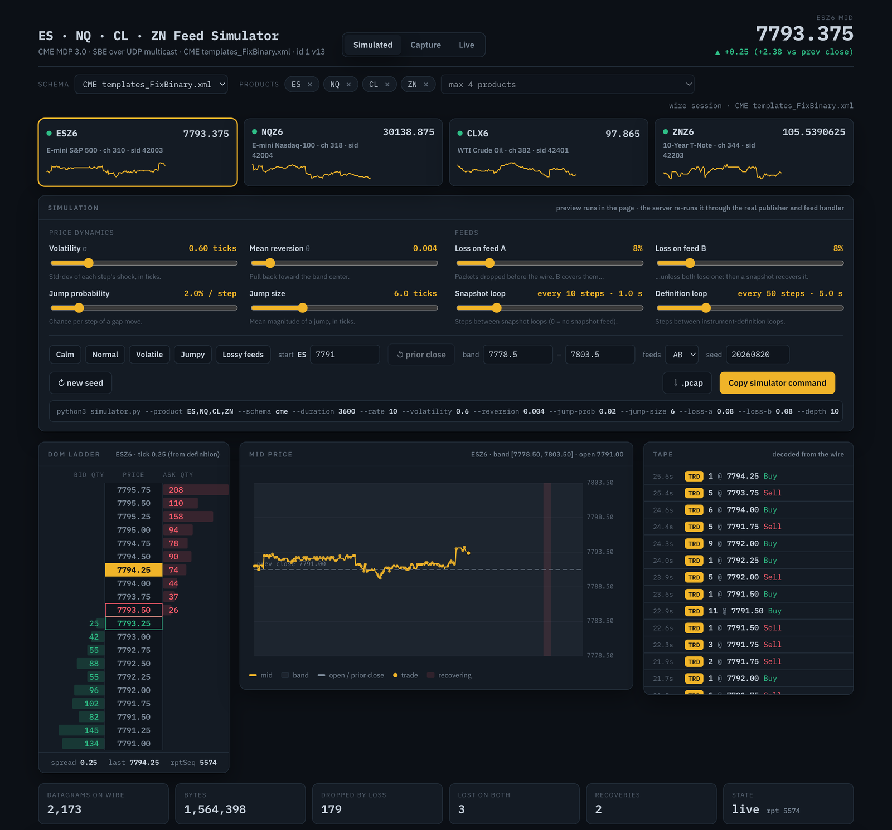
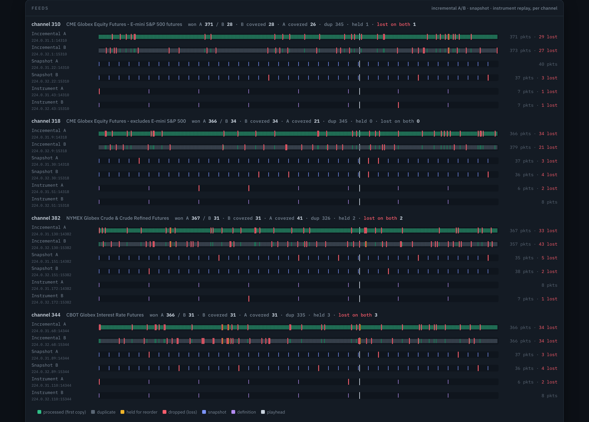
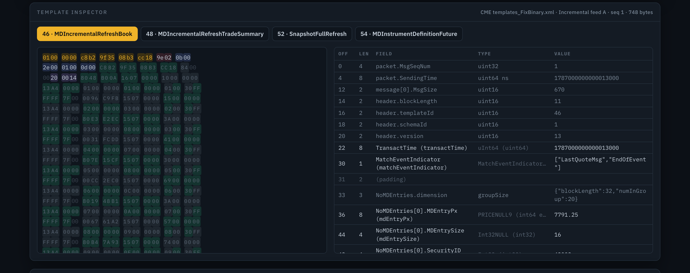

# CME MDP 3.0 Market-Data Simulator

A wire-accurate simulator that emulates the **CME Group MDP 3.0** market-data
feed. It encodes real **SBE (Simple Binary Encoding)** messages and sends them
over **UDP multicast**, driven by a bounded random walk of the price.

It defaults to the **E-mini S&P 500 (ES)** front month; `--product` picks up to
**four** futures products from CME's `config.xml` — 29 of them out of the box,
across equity index, FX, rates, grains, energy and metals. Choosing a product
sets the channel, multicast feeds, tick size, tick value and front-month
contract. Products on the same channel share its feeds, as on the real exchange.

Every channel is published the way CME publishes it: **incremental feeds A and B**
(identical packets, for arbitration), a **snapshot loop** for book recovery, and
an **instrument-definition loop** so a feed handler learns each security from
the wire. The receive side is a real feed handler — A/B arbitration, per-instrument
gap detection and snapshot recovery — behind a live terminal ladder, and every
feed can be **captured to pcap** (locally or to a VAST S3 bucket) and **replayed**.

The walk opens at **yesterday's closing price** for that product, looked up
automatically and cached. You submit a **duration** (and optionally a price
range); the mid-price does a mean-reverting random walk inside the band, the book
updates around it, and the feed streams as genuine MDP 3.0 packets. The opening
price is editable everywhere — `--start` on the CLI, a field in the dashboard,
`?start=` on the URL.



> **New here?** `./mdp3 up --products ES,NQ,CL,ZN` runs the simulator and opens a
> live ladder on all four (keys 1–4 switch, `v` splits, `q` quits). The browser
> dashboard: `python3.14 -m venv .venv && .venv/bin/pip install -r requirements.txt`,
> then `.venv/bin/python app.py`, and open <http://127.0.0.1:8000>.
> For the byte-level design, price model, feeds and diagrams see **[ARCHITECTURE.md](ARCHITECTURE.md)**.

## Requirements

**Python 3.14 or newer** — check with `python3 --version`. Every entry point
enforces it (see `pyver.py`) rather than failing later on something obscure. The
third-party dependencies are `flask`, only for the dashboard host, and `boto3`,
only for S3 capture upload/download; the simulator, codec, engine, feed handler,
consumer, ladder, local capture/replay and tests are pure standard library.

```bash
python3.14 -m venv .venv && .venv/bin/pip install -r requirements.txt
```

Name the interpreter explicitly: a bare `python3` may well be an older build,
and the venv inherits whichever one created it. If `python3 --version` already
reports 3.14+, `python3 -m venv .venv` is equivalent.

Everything except the dashboard and S3 runs straight from the checkout with no
install at all — `./mdp3 up`, `python3 simulator.py`, `python3 consumer.py`.

### Platforms

Verified on **macOS** (Apple Silicon) and **Linux** (aarch64, `python:3.14-slim`):
all four test suites, multicast end to end, the network lookup, the static build
and the Flask dashboard.

The visible difference is timestamp quality, and each run reports what it
actually got:

| | mechanism | resolution measured |
|---|---|---|
| Linux | `SO_TIMESTAMPNS` | ~41ns |
| macOS | `SO_TIMESTAMP` | 1µs |

Python exports none of those socket constants on *either* platform, which is why
`ptp.py` carries them by value.

`consumer.py` targets Unix: its kernel timestamping reads ancillary data via
`socket.recvmsg()`.

## Why it's wire-accurate

The SBE codec (`sbe.py`) is **schema-driven** — the exact byte layout lives in
`schema/mdp3.xml`, a faithful subset of CME's official `templates_FixBinary.xml`.
Encoder and decoder both read that schema, so:

- Little-endian, `blockLength/templateId/schemaId/version` SBE headers.
- CME's 3-byte repeating-group dimension (`blockLength` u16 + `numInGroup` u8).
- Prices as `int64` mantissa with constant exponent **-7** (5000.25 → 50002500000).

### Two schemas: CME's own, or the subset

Every tool runs on either, chosen with `--schema` (and a selector in the
dashboard):

| `--schema` | file | |
|------------|------|---|
| `cme` | `schema/templates_FixBinary.xml` | CME's official file, unchanged — **the default when present** |
| `subset` | `schema/mdp3.xml` | the hand-written working subset |
| `auto` | — | receivers only (consumer, ladder, replay, dashboard captures and live): detect per feed |

`wire.py` makes that possible. Code above the codec speaks one canonical
vocabulary (the subset's names); a `Wire` maps fields and groups by **FIX tag**
and enum/set values by **wire value**, so `MDEntryPx` vs `mdEntryPx`,
`NoMDEntries` vs `MDEntries`, CME's extra order-id groups and exponent -9 prices
are all handled in one place. Both files call themselves schema 1 version 13, so
a packet cannot say which layout it is; but every message is size-prefixed, and
decoding with the wrong schema leaves bytes over or runs short. `decode()`
refuses such a frame (it is counted, never applied), and `auto` uses the same
check to settle on the schema a feed is using. `$MDP3_SCHEMA` sets the default.

Get CME's `templates_FixBinary.xml` with `./mdp3 fetch-schema` (see
[Getting CME's files](#getting-cmes-files)); without it, every tool uses the subset.

## Layout

| File | Purpose |
|------|---------|
| `schema/mdp3.xml`   | SBE schema — messages, composites, enums, sets, groups |
| `sbe.py`            | Schema-driven SBE encoder/decoder |
| `packet.py`         | Binary Packet Header + message framing |
| `engine.py`         | Price random walk + order-book / increment generation |
| `contracts.py`      | Contract specs (tick, tick value, cycle) + front-month dates |
| `products.py`       | Reads CME's `config.xml`; joins channels/feeds to contract specs |
| `schema/config.xml` | CME's channel configuration (download it; gitignored) |
| `schema/config.sample.xml` | Hand-written factual summary of the channels used (the fallback) |
| `cme_files.py`      | `./mdp3 fetch-schema` / `fetch-config`: CME's files from its FTP server |
| `settlement.py`     | Looks up & caches the prior session's close; derives the band |
| `mdp3`, `launcher.py` | One entry point: `./mdp3 up` runs everything, `./mdp3 <tool>` runs one |
| `simulator.py`      | Main sender — up to 4 products, every feed of their channels |
| `channel.py`        | One channel's publisher: incremental A/B, snapshot and definition loops |
| `transport.py`      | Outbound multicast socket, per-feed loss injection, pcap tap |
| `consumer.py`       | Feed handler CLI — arbitration, recovery, PTP timestamps, threaded receive |
| `feedhandler.py`    | A/B arbitration, per-instrument `rptSeq` recovery, definitions |
| `book.py`           | Market-by-price book rebuilt from incrementals and snapshots |
| `receiver.py`       | Multicast join, bound per group (feeds share ports) |
| `ladder.py`         | Live terminal DOM ladder for up to 4 products |
| `capture.py`        | Capture service — every feed to pcap, flushed to S3 and/or disk |
| `replay.py`         | Replays captures (files, dirs, `s3:`) onto multicast, or decodes them |
| `pcap.py`           | pcap writer; pcap/pcapng reader (Ethernet, VLAN, SLL, raw, loopback) |
| `s3store.py`        | S3 (VAST) config, upload, `ls`/`get`/`verify` |
| `lifecycle.py`      | SIGINT/SIGTERM → clean shutdown with summary |
| `deploy.sh`, `deploy/mdp3-capture.service` | Push to the capture VM; systemd `--user` unit |
| `config.env.example`, `capture.env.example` | S3 credentials / capture settings templates |
| `ptp.py`            | IEEE 1588 receive timestamping, TAI formatting, latency stats |
| `pyver.py`          | Python version floor, shared by every entry point |
| `record_session.py` | Records a session to JSON (`build_session()` reused by the app) |
| `app.py`            | Flask app — the dashboard: simulated, capture and live modes, its API |
| `session.py`        | Dashboard sessions: publisher → loss → feed handler → session JSON; captures too |
| `live.py`           | Live mode: a shared feed-handler monitor streamed as server-sent events |
| `wire.py`           | Schema-neutral messages: CME's `templates_FixBinary.xml` or the subset |
| `web/`              | Dashboard front end: `index.html`, `app.css`, `app.js`, `engine.js` (Python-identical engine) |
| `build_dashboard.py`| Bakes a static, serverless `dashboard.html` with assets inlined |
| `dashboard.html`    | Static dashboard — *generated* by `build_dashboard.py`, not in the repo |
| `session.json`      | Recorded session JSON — *generated*, not in the repo |
| `test_roundtrip.py` | Wire-correctness tests (encode → bytes → decode) |
| `test_start_price.py`| Opening-price tests (engine start, band, close lookup) |
| `test_products.py`  | Product chooser tests (specs, front months, config parsing) |
| `test_timestamps.py`| Timestamping + threaded receive tests (real kernel or faked) |
| `test_feeds.py`     | Snapshot/definition wire, multi-product channels, arbitration, recovery |
| `test_pcap.py`      | pcap formats, replay timing, capture/replay S3 path |
| `test_wire.py`      | Both schemas: translation, mismatch detection, auto-detect, byte maps |
| `test_dashboard.py` | Sessions, the Flask API, live SSE, static build, JS engine parity |
| `requirements.txt`  | Python deps (`flask` for `app.py`, `boto3` for S3) |
| `ARCHITECTURE.md`   | Byte-level wire format, codec design, price model, diagrams |

## Messages implemented

- `MDIncrementalRefreshBook` (template 46) — bid/offer book updates (New/Change/Delete)
- `MDIncrementalRefreshTradeSummary` (template 48) — trade prints with aggressor side
- `SnapshotFullRefresh` (template 52) — full book + session stats per instrument, on the snapshot feed
- `MDInstrumentDefinitionFuture` (template 54) — symbol, tick, contract, limits, on the instrument replay feed
- `SecurityStatus` (template 30)

Templates 52 and 54 match CME's `templates_FixBinary.xml` byte for byte — the
tests decode the simulator's output with CME's own file when it is present.

## Choosing a product

The simulator reads CME's **`config.xml`** — the channel configuration mapping
products to channels and multicast feeds — and joins it to the contract specs in
`contracts.py`. List what you can simulate:

```bash
python3 products.py                 # every product, grouped
python3 products.py --show CL       # one product in detail
```

```
code  product                  group    exch   ch    front    feed
ES    E-mini S&P 500           Equity   CME    310   ESZ6     224.0.31.1:14310
CL    WTI Crude Oil            Energy   NYMEX  382   CLX6     224.0.31.130:14382
ZN    10-Year T-Note           Rates    CBOT   344   ZNZ6     224.0.31.68:14344
```

Then point anything at it — ES stays the default:

```bash
python3 simulator.py --product CL --duration 3600
python3 simulator.py --product ES,NQ,CL,ZN --duration 3600     # up to four at once
python3 record_session.py --product GC --steps 400
python3 build_dashboard.py --product ZN
```

### Several products at once

`--product` takes up to four codes, comma-separated or repeated, on the
simulator, consumer, ladder, capture and replay alike. Each product runs its own
walk from its own prior close. Products on **different channels** go out on
their channels' own multicast groups; products on the **same channel** — NQ and
RTY are both on 318, the five FX futures on 314 — share that channel's feeds and
its packet sequence, and are told apart by security id and their own `rptSeq`,
exactly as on CME.

Price flags then take `CODE=value` pairs: `--start ES=7772.50,CL=92 --band
CL=2`. `--group`, `--port` and `--security-id` apply to a single product only.

The dashboard stays single-product; its chooser switches between them.

The dashboard has a **product chooser** in the header, grouped by asset class.

### Getting CME's files

This repository doesn't redistribute CME's files. Fetch them yourself, from
CME's anonymous FTP server, into `schema/`:

```bash
./mdp3 fetch-cme        # both files below
./mdp3 fetch-schema     # templates_FixBinary.xml — the SBE schema for --schema cme
./mdp3 fetch-config     # config.xml — every channel, thousands of products
```

Each download is validated before it replaces anything: the schema must define
templates 46/48/52/54, and the config must list futures channels. Both files are
gitignored; they remain CME Group's, and their use is subject to CME's terms.
The fetch uses `ftp.cmegroup.com`, not the cmegroup.com website, whose Data Terms
of Use prohibit automated access.

Without `config.xml`, the committed **`schema/config.sample.xml`** is used: a
hand-written factual summary, not CME's file. It covers just the 9 futures
channels that host the products below, with their product codes and the multicast
addresses and ports of each channel's incremental, snapshot and instrument-replay
feeds. With `config.xml` present it is preferred automatically; point elsewhere
with `--config /path/to/config.xml` or `$CME_CONFIG_XML`.

**Options channels are ignored.** A code like `ES` is listed on its futures
channel (310) *and* on two options channels; only channels whose label says
Futures are considered, so `ES` always resolves to 310.

### Front month

The front month is always assumed — the nearest listed contract whose last trade
date is on or after today, so it rolls the day after expiry:

```bash
python3 contracts.py            # every product's front month and expiry
# ES    E-mini S&P 500    ESZ6   2026-12-18   0.25   12.5
# CL    WTI Crude Oil     CLX6   2026-10-20   0.01     10
```

Expiry rules follow CME's rulebook in shape (third Friday for equity index, N
business days before month end for treasuries, and so on) but **ignore exchange
holidays**, so a date can be a day off when a holiday falls in the window. That
is fine for picking a front month; it is not a settlement calendar.

### Contract economics

CME's `config.xml` carries no tick sizes — those live in `contracts.py`, keyed by
the same product codes. Tick size and tick value are the real contract specs;
**security IDs are synthetic** (on a real feed they arrive in the security
definition messages), and ES keeps `42003`, the id this simulator has always
used. To simulate a product not in that table, add a `ContractSpec` for it.

## Starting price

By default the simulator opens at the **previous session's close** for the
selected product and builds a **100-tick** band around it — 25 points of ES, $1.00
of crude, 1.5625 of a 10-year note — so a bare `python3 simulator.py` starts at a
realistic price with no arguments:

```bash
python3 settlement.py
# ES=F 2026-09-23 close 7772.50 (yahoo)
#   suggested band: [7760.0, 7785.0]
```

The close comes from Yahoo Finance's public chart endpoint for the product's
continuous front-month symbol (`ES=F`, `CL=F`, …), fetched with the standard
library and cached per symbol in `.prior_close_cache.json` (re-fetched at most
every 4 hours). If the network is unavailable the cached value is reused and
flagged **stale**; with no cache either, the product opens at a rough **fallback
reference level** — labelled as such, never presented as a quote — so the
simulator always runs offline. (Yahoo has no usable history for `EMD`, which
therefore always opens at its reference level.)

> CME's own settlements endpoint is deliberately **not** used — its Data Terms of
> Use prohibit automated access. Yahoo's number is a consolidated close, not
> CME's official settlement price; pass `--start` when you need the exact settle.

Override the opening price anywhere:

```bash
python3 simulator.py --start 7772.50                 # explicit open, band derived
python3 simulator.py --start 7772.50 --band 40       # 40-point band around it
python3 simulator.py --low 7700 --high 7800          # explicit band, open at close
python3 simulator.py --product CL --start 92.00      # any product, same flags
python3 simulator.py --offline                       # never touch the network
python3 simulator.py --refresh                       # force a re-fetch
```

Rules, in order: an explicit `--start` always wins; explicit `--low`/`--high`
always win over the derived band; anything left over is filled in around the
opening price. An explicit `--start` outside the band is clamped into it. If the
*prior close* falls outside a band you set explicitly, the walk opens at the band
center instead — the price and the band you asked for are both left honest.

The opening price becomes the opening **best bid**; with a one-tick-wide market
the opening mid therefore sits half a tick above it (7772.50 → mid 7772.625).
Prices snap to the *selected product's* tick grid, so a Japanese Yen close of
0.006332 stays 0.006332 rather than being quantized to the ES tick.

## Feeds: A/B, snapshot, instrument definitions

For each channel the simulator publishes six multicast feeds, all read from
`config.xml`:

| feed | carries | cadence |
|------|---------|---------|
| Incremental A + B | book (46) and trades (48), byte-identical on both | every step |
| Snapshot A + B | one `SnapshotFullRefresh` per instrument; sequence restarts each loop | `--snapshot-interval` (1s) |
| Instrument Replay A + B | one `MDInstrumentDefinitionFuture` per instrument | `--secdef-interval` (5s) |

A definition and a snapshot loop go out at startup, before the first book update.
`--feeds A` publishes one side only; `--snapshot-interval 0` / `--secdef-interval
0` turn a loop off.

**Making loss happen.** Nothing is ever lost on loopback, so arbitration and
recovery would have nothing to do. `--loss-a 0.05 --loss-b 0.05` drops that
fraction of each feed's packets before they reach the wire (and the pcap). A
packet lost on one feed is covered by the other; one lost on both is a real gap
and the handler recovers from the next snapshot.

## Feed handler (`consumer.py`)

By default the consumer joins every feed of its products' channels and runs them
through `feedhandler.py`:

- **A/B arbitration** — the first copy of each sequence number wins; a packet
  ahead of sequence is held briefly (`--window`, `--hold-ms`) in case the other
  feed is just slower. The report shows how many each feed won, how many only one
  feed delivered, and how many neither did.
- **Recovery** — each instrument's `rptSeq` must advance by one. On a skip (or
  a late join) that instrument buffers its entries until the next snapshot,
  rebuilds its book from it, replays what it buffered, and goes live. Other
  instruments on the channel are not disturbed. A live book is also cross-checked
  against every snapshot, and any mismatch is reported.
- **Definitions** — security id → symbol, tick, decimals, channel, limits,
  learned from the instrument replay feed.

```bash
python3 consumer.py --product ES,NQ,CL --summary
python3 simulator.py --product ES,NQ,CL --loss-a 0.1 --loss-b 0.1 --duration 30
```

```
  ** gap        ch 310 packets 58 lost on both feeds
  ** gap        ESZ6 rptSeq 1208 -> 1233: 24 entries missed, recovering from snapshot
  ** recovered  ESZ6 recovered from snapshot at rptSeq 1276 (+0 buffered entries replayed)
...
  channel 310: won A 67 / B 12  dup 64  held 2  lost on both 1 (1 gap(s))  covered by B 9  covered by A 6
    ESZ6     live       rptSeq 1703  bid 7772.25 / offer 7772.50  gaps 1  recoveries 1  snapshot checks 6 (0 mismatch)
```

`--feeds A` disables arbitration, `--no-recovery` applies entries across gaps,
and `--raw` (or `--group`/`--port`) listens to one group and prints every
message, as the consumer always used to.

## Live ladder (`ladder.py`)

A terminal depth-of-market for up to four products, on the same feed handler:

```bash
python3 ladder.py --product ES,NQ,CL,ZN --iface 127.0.0.1
```

Keys **1–4** / **Tab** pick a product, **v** toggles a side-by-side split of all of
them, **q** quits. The header shows each instrument's state (live/recovering),
its `rptSeq`, gaps and recoveries, and the channel's A/B tallies. Tick size and
decimals come from the instrument definition once it arrives.

## Capture & replay (pcap, S3)

Everything that goes on the wire can be kept and played back.

```bash
python3 simulator.py --product ES,CL --pcap session.pcap       # what the sim sent
python3 capture.py --product ES,CL --local-dir ./pcaps         # what a host received
python3 replay.py session.pcap                                 # back onto multicast
python3 replay.py ./pcaps --speed 5 --loop 0                   # 5x, forever
python3 replay.py session.pcap --dry-run                       # decode + report only
python3 pcap.py session.pcap                                   # feeds, packets, span
```

- **`capture.py`** joins every feed of up to four products (or `--kinds`,
  `--feeds`, any `--join GROUP:PORT`), timestamps each datagram with the kernel
  clock where available, and every `--interval` seconds (default 3) writes the
  window as a standalone nanosecond pcap — to the S3 bucket in `config.env`,
  to `--local-dir`, or both. No root needed: capture is at the socket layer and
  the Ethernet/IP/UDP headers are synthesized, so Wireshark and tcpdump read the
  files as ordinary UDP multicast. Keys are
  `<S3_PREFIX>/<host>/YYYY/MM/DD/mdp3-YYYYMMDDTHHMMSSZ-mmm.pcap`.
- **`replay.py`** sends each datagram back to its original group and port at the
  capture's timing (`--speed`, `--max-gap`, `--loop`, `--product` filter). Sources
  are files, directories, or S3 prefixes (`s3://bucket/prefix`, or `s3:prefix`
  with the bucket from `config.env`). It reads classic pcap and pcapng, including
  real captures (Ethernet with VLAN tags, Linux cooked, raw IP, `tcpdump -i lo0`).
- **`s3store.py`** `ls` / `get --out DIR` / `verify` (decode the newest capture
  through the feed handler).

S3 credentials live in `config.env` (copy `config.env.example`, `chmod 600`),
never on a command line. With nothing configured, capture needs `--local-dir`.

### The capture VM

```bash
HOST=user@capture-vm ./deploy.sh              # copy to ~/cme-mdp3-sim there, build the venv
HOST=user@capture-vm ./deploy.sh --service    # + install and (re)start the systemd --user capture unit
```

`HOST` is required — set it in the environment or in an untracked `deploy.env`
(`HOST=user@host`) next to the script; `DIR=` changes the target directory. The
VM needs Python 3.14+. On the VM,
create `config.env` (bucket credentials) and optionally `capture.env`
(`PRODUCTS=ES,NQ,CL,ZN`, `IFACE`, `INTERVAL` — see `capture.env.example`); the
unit reads both and restarts on failure. `journalctl --user -u mdp3-capture -f`
shows each flush.

## One command (`./mdp3`)

`./mdp3 up` replaces the three terminals this used to take (capture, ladder,
simulator):

```bash
./mdp3 up                                         # simulator + ladder, ES
./mdp3 up --products ES,NQ,CL,ZN --capture        # + capture (S3 if configured, else ./pcaps)
./mdp3 up --replay ./pcaps --speed 2              # replay instead of simulating
./mdp3 up --no-ladder --duration 60               # headless: consumer in the foreground
./mdp3 up --loss-a 0.05 --loss-b 0.05             # watch arbitration and recovery
./mdp3 up --products ES,CL --dashboard --open     # + the browser dashboard on the live feed
./mdp3 up --schema subset                         # send the subset; receivers auto-detect
```

The background pieces log to `logs/<name>.log`; when you quit the ladder (or
press Ctrl-C) everything stops and each tool's summary is printed. Every tool is
also reachable directly, arguments passed through: `./mdp3 sim …`, `consumer`,
`ladder`, `capture`, `replay`, `products`, `pcap`, `s3`, `dashboard`; `./mdp3 test`
runs every suite and `./mdp3 deploy` runs `deploy.sh`.

## Dashboard (local Flask app)

The browser dashboard runs on the same code as the terminal tools — the
publisher, loss model, wire layer and feed handler — and shows any of three
sources:

| mode | what it shows |
|------|---------------|
| **Simulated** | up to four products, all six feeds per channel, with loss on A and B; books, trades, recoveries and definitions as the feed handler decoded them |
| **Capture** | a `.pcap`/`.pcapng` — uploaded (drag and drop), from the capture directory (`./pcaps`), or from the S3 bucket in `config.env` — decoded the same way; real CME captures included |
| **Live** | the real multicast feed (the simulator, a replay, a line) through the feed handler, streamed to the page with server-sent events |

It needs the venv from [Requirements](#requirements) (Flask). Run it:

```bash
.venv/bin/python app.py                       # http://127.0.0.1:8000
.venv/bin/python app.py --captures /data/pcaps
./mdp3 up --products ES,CL --dashboard --open # simulator + dashboard in live mode
```

By default it binds to **localhost only**. `--host 0.0.0.0` exposes it to your
LAN — it has no authentication, so only on a trusted network.

**What's on the page**

- **Instrument tabs** (up to four; keys 1–4) with mid, state (live / recovering)
  and a sparkline; a product chooser and a **schema** selector in the toolbar.
- **Simulation panel** — price dynamics (σ, θ, jumps), the selected product's
  opening price and band, seed, and the feed knobs: loss on A, loss on B,
  snapshot and definition loop intervals, A/B/both. Presets include *Lossy feeds*.
  **⇩ .pcap** downloads exactly this session's datagrams; **Copy simulator
  command** gives the `simulator.py` flags that put it on the live feed.
- **DOM ladder, mid chart, tape** — the chart shades the stretches where the
  instrument was recovering; the ladder says when its book is stale.
- **Feeds** — one lane per feed per channel (incremental A/B, snapshot A/B,
  instrument A/B) with every packet marked processed, duplicate, held for
  reorder, or dropped; A/B tallies (who won, who covered whom, lost on both);
  click a lane to jump to that packet. The event list shows gaps, recoveries,
  definitions and schema detection as they happened.
- **Template inspector** — one real packet per template (46, 48, 52, 54): hex
  bytes and a field table side by side, every byte attributed to its field at its
  offset (packet header, SBE header, root fields, padding, group dimensions,
  entries), in the selected schema's own names with the canonical name
  alongside. Hover either side to highlight the other.
- **Instrument definitions** — template 54 as decoded: symbol, security id,
  tick, decimals, tick value, contract size, maturity, limits, reference price.





**Tuning is instant and exact.** Moving a slider re-runs the walk in the page
(`web/engine.js`), which ports CPython's Mersenne Twister, `gauss` and
round-half-even, so the preview *is* the simulator's path for that seed — the
tests check it step for step against `engine.py`. A moment later the server
re-runs the session through the publisher and feed handler and the feed panels,
inspector and recovery events update.

Every setting is in the URL, so a view can be bookmarked or shared:

```
/?products=ES,NQ,CL,ZN&loss_a=0.05&loss_b=0.05
/?products=CL&schema=subset&volatility=1.2&jump_prob=0.04&seed=7
/?products=ES,CL&start=ES=7772.50,CL=92&band=ES=40
/?products=ES,NQ,CL,ZN&loss_a=0.08&loss_b=0.08&frame=260   # open at step 260
/?mode=capture&src=local:session.pcap
/?mode=live&products=ES,NQ&iface=127.0.0.1
```

API: `GET /api/session` (JSON), `GET /api/session.pcap`, `GET /api/captures`,
`GET /api/capture?src=local:…|s3:…` and `POST /api/capture` (upload, 128 MB max),
`GET /api/live?products=…&schema=auto&iface=…&feeds=AB` (`text/event-stream`),
`GET /api/products`, `/api/schemas`, `/api/prior-close?product=GC`, `/healthz`.
Captures are served only from the capture directory and the configured S3
prefix; uploads are size-limited; pages are sent with a restrictive
Content-Security-Policy.

## Timestamps & latency

`consumer.py` behaves like a real feed handler. Every datagram is stamped as
close to the wire as the platform allows and reported on the IEEE 1588 (PTP)
TAI timescale, and transit is measured against the `sendingTime` in the packet
header:

```bash
python3 consumer.py --summary
python3 consumer.py --product CL --summary     # follow a different feed
```

```
Listening on 224.0.31.1:14310 (iface 127.0.0.1)  schema id=1 v13
  clock  SO_TIMESTAMP (kernel, 1µs resolution)
  Python 3.14.3 (GIL)  ·  receive thread + decode thread

seq=1      ptp=1790290256.335946000  transit=  214.0µs  2 msg [Book,TradeSummary] 732B
seq=2      ptp=1790290256.461729000  transit=  253.0µs  1 msg [Book] 676B
...
Received 12 packets in 1.38s  ·  0 sequence gap(s)
  clock         SO_TIMESTAMP (kernel, 1µs resolution)
  PTP epoch     TAI (UTC + 37s) — this is PTP formatting and measurement, not grandmaster sync
  transit: min 214.0µs  p50 560.0µs  p99 680.0µs  max 680.0µs  mean 498.6µs
  inter-arrival: min 123.98ms  p50 125.06ms  p99 126.03ms  max 126.03ms
  jitter        968.0µs (p99 - p50 of inter-arrival)
```

### Where the timestamp comes from

`--clock` picks the source; `auto` takes the best available and always reports
what it actually got:

| Platform | Mechanism | Payload | Resolution |
|----------|-----------|---------|-----------|
| Linux | `SO_TIMESTAMPNS` | `struct timespec` | nanoseconds |
| macOS / BSD | `SO_TIMESTAMP` | `struct timeval` | microseconds |
| anywhere | userspace clock read after `recvmsg` | — | clock resolution |
| anywhere | `--clock synthetic` | fabricated control message | clock resolution |

Python does not export these socket constants on every platform, so `ptp.py`
supplies them by value. **If the running kernel cannot timestamp, it is faked:**
`--clock synthetic` fabricates exactly the control message the kernel would have
attached, so the parsing and measurement path is identical — and every line of
output labels it `FABRICATED`. That is also how the tests cover the feature on
machines with no kernel support.

This is PTP *formatting and measurement*, **not** PTP *sync*: nothing disciplines
this host's clock to a grandmaster. Across two hosts without a shared time
source, transit is dominated by clock offset, and the consumer says so when the
median goes negative. `--tai-offset` sets the UTC→TAI leap seconds (37 today).

### Threading

The receive thread does nothing but `recvmsg`, stamp and enqueue. Decoding runs
on the main thread behind a bounded queue, so a slow decoder cannot delay the
next packet — the mistake that makes a naive handler's latency numbers measure
its own decoder. Queue overruns are counted the way a real handler counts kernel
drops, and `--queue` sets the depth. `--no-threads` decodes inline instead, which
is useful for comparison.

Threads earn their place in two other spots: `settlement.prefetch()` looks up
many products' closes at once (29 symbols in ~0.4s instead of ~10s serially, with
a lock around the shared cache file), and the Flask app serves `threaded=True`
so one slow session build does not block every other request.

```bash
python3 settlement.py --all          # every product's close, concurrently
```

## Quick start

Run the tests:

```bash
./mdp3 test                   # all eight suites
python3 test_roundtrip.py     # wire: encode -> bytes -> decode
python3 test_start_price.py   # opening price: engine, band, close lookup
python3 test_products.py      # products: specs, front months, config parsing
python3 test_timestamps.py    # PTP timestamps + threaded receive path
python3 test_feeds.py         # snapshot/definitions, multi-product, A/B, recovery
python3 test_pcap.py          # pcap formats, replay, S3 path
python3 test_wire.py          # CME schema vs subset: translation, detection
.venv/bin/python test_dashboard.py   # dashboard API, live stream, JS engine parity
```

Terminal 1 — start a consumer (joins the multicast group and decodes):

```bash
python3 consumer.py --summary
```

Terminal 2 — run the simulator for an hour, opening at yesterday's ES close in a
25-point band around it:

```bash
python3 simulator.py --duration 3600 --rate 20
```

Defaults match CME **channel 310** (E-mini S&P 500): incremental `224.0.31.1:14310`
(A) and `224.0.32.1:15310` (B), plus its snapshot and instrument replay feeds —
read from `config.xml`, not hardcoded. TTL defaults to 0 (this host only) so nothing
leaves your machine; raise `--ttl` to reach the LAN.

### Static, serverless dashboard

To bake a self-contained `dashboard.html` you can open directly (file://) —
stylesheet, scripts and one session inlined:

```bash
python3 build_dashboard.py --product ES,NQ,CL,ZN --loss-a 0.05 --loss-b 0.05
python3 build_dashboard.py --start 7772.50 --band 40 --schema subset --pcap dash.pcap
```

The static page keeps playback, the instant in-page tuning of price dynamics,
and the baked session's feed lanes, inspector and definitions. Capture, live,
and re-running feed settings need the server.

## Key options

`simulator.py`: `--product --start --band --low --high --offline --refresh
--duration --rate --depth --volatility --reversion --jump-prob --jump-size
--feeds --snapshot-interval --secdef-interval --loss-a --loss-b --pcap --pcap-usec
--security-id --group --port --iface --ttl --seed --quiet`

`consumer.py`: `--product --feeds --no-recovery --window --hold-ms --raw --group
--port --iface --count --summary --quiet --clock --tai-offset --queue --no-threads`

`ladder.py`: `--product --feeds --iface --fps --split --print-after`

`capture.py`: `--product --kinds --feeds --join --iface --interval --local-dir
--env-file --empty-windows --usec`

`replay.py`: `paths… --speed --loop --max-gap --product --iface --ttl --dry-run --quiet`

`./mdp3 up`: `--products --replay --speed --duration --rate --capture --local-dir
--interval --no-ladder --consumer --dashboard --port --open --schema --iface --ttl
--loss-a --loss-b --sim-args --offline`

`app.py`: `--host --port --captures --debug`  ·  `record_session.py` /
`build_dashboard.py`: the simulator's dynamics and feed flags plus `--schema
--snapshot-every --secdef-every --pcap --out`

`--schema` (`cme`, `subset`, a path; receivers also `auto`) is accepted by the
simulator, consumer, ladder, replay, record_session and build_dashboard.

`products.py`: `--config --group --show`  ·  `contracts.py`: `[codes…]`

`settlement.py`: `--product --symbol --all --offline --refresh --json`

`--group`/`--port`/`--security-id` default to the selected product's values and
override them when passed.
